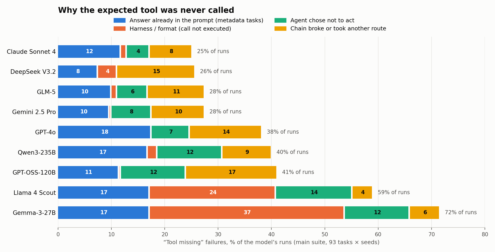
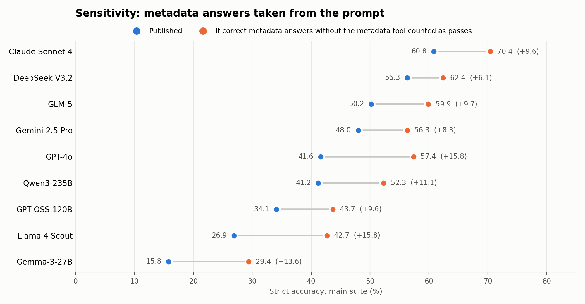

# Why was the expected tool never called? A breakdown of GNA's "tool missing" failures

> The extended analysis (blind second-labeller check, 91% family agreement; robustness tests) is in `tables/audit_agreement.json` and `tables/robustness.json`. Notably, `get_layer_bounds` is never mentioned in the prompt yet is called only 26% of the time, so models skip tools whose answer is already in their context, not only because they were told to.

*Post-publication analysis, 2026-11-03, of the raw traces behind the published results. Not peer reviewed.*

## TL;DR

- The paper's headline holds by the scorer's definition: **972 of 1,429 failed runs (68.0%) are `tool_missing`**. This analysis reproduces that number exactly from the raw traces.
- Inside that 68%, there are four very different causes:

| Family | Runs | % of tool-missing | % of all failures |
|---|---:|---:|---:|
| **1 · Answer already in the prompt** (metadata tasks answered from the system prompt) | **322** | **33.1%** | 22.5% |
| **2 · Harness / format**: the call was written as text and never executed, or the answer was empty | 190 | 19.5% | 13.3% |
| **3 · The agent chose not to act**: `reject_task`, asked the user, refused, answered from knowledge | 207 | 21.3% | 14.5% |
| **4 · The chain broke or took another route**: different analysis tool, skipped lookup, tool error, ran out of rounds | 253 | 26.0% | 17.7% |

- ⚠️ **Family 1 can be read as a benchmark-design conflict or as an intended verification test** (both readings are discussed in `../README.md`).
  - The v3 system prompt contains a `KNOWN DATA` block with every layer's legend and coverage. It tells the agent to *"use this instead of calling list_layers or get_legend"* and to *"NOT call list_layers or get_legend first"*.
  - **17 of the 21 `tool_selection` tasks** score those very metadata calls as required.
  - **269 of the 322 runs passed every other check**: the answer was correct, but no tool was called.
  - This conflict explains most of the paper's "tool selection: no model above 37%".
- **Sensitivity:** counting those 269 correct answers as passes would raise every model by 6–16 points. Claude Sonnet 4 would go from 60.8% to 70.4%. The **top three keep their order**, and GPT-4o moves above Gemini 2.5 Pro.
- **True "agent decision" failures are a minority.** Real fabrication (giving numbers on a data question without calling any tool) is rare: **14 runs, 12 of them Gemma**.
- **A second wording issue:** 8 tasks ask about CO₂ **"geological storage"**, but the layer (and the prompt) describe CO₂ **absorption** projects (legislation screening).
  - Those 8 tasks pass 33.8% of the time, against 45.6% for all other tasks.
  - 57 tool-missing answers explicitly refuse on these grounds ("I have absorption data, not geological storage").



---

## 1. Data and method

**Labels: which runs failed, and why, according to the scorer.** These are the canonical paper data.
- **7 models:** `GeoNatureAgent_Benchmark/paper/final_results/per_case.csv`.
- **GPT-4o and Gemma-3-27B:** `results/run_{gpt4o,gemma3}_openrouter_v5/results.jsonl`, with the paper's capability rule (a run that fails *only* on cost is excused), exactly as `scripts/add_models_to_leaderboard.py` does.
- **Result:** 1,429 failed runs. The failure-mode table equals the paper's: tool missing 972 (68.0%), keyword 276 (19.3%), wrong data 139 (9.7%), forbidden keyword 19, rounds 18, chart 5.

**Behaviour: what the agent actually did.** This comes from the raw traces in `~/geonature_zenodo_v2/raw_traces/geonature-agent-results/`, the full 797 MB GCS backup.
- **Matching:** several candidate runs exist per model, so `scripts/01_match_runs.py` picks the run that reproduces the published per-case pass/fail and check scores.
  - Five models match **279/279**.
  - GPT-OSS-120B matches 268/279.
  - Claude Sonnet 4 matches 151/186 (its 2 published seeds; the remaining rows are most likely rescored).
- **Coverage:** all 972 tool-missing runs have a trace, and the trace's own label is `tool_missing` in 972/972.

**Classification.** `scripts/02_build_dataset.py` assigns each tool-missing run exactly one sub-type, using rules applied in priority order. It reads the tools called, the expected and missing tools, the tool results (errors), the round count and the final answer text.

| Code | Sub-type | Rule (simplified) |
|---|---|---|
| T1 | Wrote the tool call as text | The answer contains tool-call syntax (```` ```tool_code ````, `"function": {"name": …}`, `analysis(…)`, `<\|python_start\|>`…) and the expected tool is missing |
| A1 | Empty answer | No tool and fewer than 40 characters of answer |
| A2 | Answered a metadata question from the prompt | No tool, and every missing tool is a metadata tool (`get_legend`, `list_layers`, `get_layer_bounds`, `get_layer_info`) |
| A3 | Announced a call, then stopped | No tool; the answer ends with "I will now analyze…" or "Let me…" |
| A4 | Asked the user instead | No tool; a clarifying question, or "would you like…" |
| A5 | Refused / claimed a limitation | No tool; "I can't", "not available", "outside coverage"… |
| A6 | Gave data numbers without a tool | No tool, percentages in the answer, no refusal |
| A7 | Answered from knowledge | No tool, none of the above |
| B1 | Called `reject_task` | Rejected and called no expected tool |
| B2 | Ran out of rounds | Rounds ≥ the case's `max_rounds` |
| B3 | Gave up after a tool error | A tool returned an error and the agent didn't recover |
| C1 | Skipped the geocoding step | Only `lookup_*` missing, but an analysis tool ran |
| C2 | Used a different analysis tool | An expected analysis tool is missing; another analysis tool ran |
| C3 | Missed a display or metadata tool | Only `toggle_layer` / `generate_chart` / a metadata tool is missing |
| C4 | Other incomplete chain | Everything else |

**Flags added to every run:**
- `other_checks_all_pass`: every check except `expected_tools` and cost passed. This is the objective "right answer, wrong process" test.
- `answer_geological_vs_absorption`
- `hit_round_limit`
- `n_tool_errors`
- the raw regex flags.

## 2. Results

### 2.1 Sub-types (all 9 models, 972 runs)

| Family | Sub-type | Runs | % of tool-missing | Otherwise correct |
|---|---|---:|---:|---:|
| 1 Prompt conflict | A2 metadata answered from the prompt | 322 | 33.1 | **269** |
| 2 Harness | T1 tool call written as text | 146 | 15.0 | 8 |
| 2 Harness | A1 empty answer | 44 | 4.5 | 0 |
| 3 Agent decision | B1 called `reject_task` | 63 | 6.5 | 9 |
| 3 Agent decision | A4 asked the user | 50 | 5.1 | 8 |
| 3 Agent decision | A7 answered from knowledge | 40 | 4.1 | 2 |
| 3 Agent decision | A5 refused / claimed a limit | 21 | 2.2 | 11 |
| 3 Agent decision | A3 announced a call, then stopped | 19 | 2.0 | 0 |
| 3 Agent decision | A6 data numbers without a tool | 14 | 1.4 | 3 |
| 4 Chain | C2 different analysis tool | 131 | 13.5 | 31 |
| 4 Chain | C1 skipped geocoding | 47 | 4.8 | 4 |
| 4 Chain | C3 missed a display/metadata tool | 21 | 2.2 | 12 |
| 4 Chain | B3 gave up after a tool error | 19 | 2.0 | 5 |
| 4 Chain | C4 other incomplete chain | 19 | 2.0 | 0 |
| 4 Chain | B2 ran out of rounds | 16 | 1.6 | 1 |

**363 of the 972 tool-missing runs (37%) passed every other check.**

### 2.2 By model (tool-missing runs per family)

| Model | Runs | Tool-missing | 1 Prompt | 2 Harness | 3 Decision | 4 Chain |
|---|---:|---:|---:|---:|---:|---:|
| Claude Sonnet 4 | 186 | 47 | 22 | 2 | 8 | 15 |
| DeepSeek V3.2 | 279 | 72 | 21 | 10 | 0 | 41 |
| GLM-5 | 279 | 77 | 28 | 3 | 16 | 30 |
| Gemini 2.5 Pro | 279 | 77 | 27 | 1 | 21 | 28 |
| GPT-4o | 279 | 107 | 49 | 0 | 20 | 38 |
| Qwen3-235B | 279 | 112 | 47 | 5 | 34 | 26 |
| GPT-OSS-120B | 279 | 115 | 32 | 1 | 34 | 48 |
| Llama 4 Scout | 279 | 165 | 48 | **66** | 40 | 11 |
| Gemma-3-27B | 279 | 200 | 48 | **102** | 34 | 16 |

**How to read it:**
- **Strong models** fail mostly through the prompt conflict and through choosing a different route.
- **Llama and Gemma** fail mostly through **harness/format**. Their calls are written as text (Llama's Python style with `<|python_start|>` tokens; Gemma's JSON blocks inside ```` ```tool_code ````), which the universal parser still doesn't execute.
- **Over-cautious decisions** (`reject_task`, asking the user) are concentrated in GPT-OSS-120B, Qwen3, Llama and Gemini.

### 2.3 By category and by tool

- **`tool_selection` accounts for 393 of the 972 tool-missing runs, and 322 of those are the prompt conflict.** No other category comes close: deep dive 95, interpretation 83, cross-indicator 66.
- **Most-missed expected tools:**

  | Tool | Runs where it was missing |
  |---|---:|
  | `analyze_area` | 341 |
  | `lookup_province` | 313 |
  | `get_legend` | 143 |
  | `find_top_n` | 113 |
  | `list_layers` | 105 |
  | `get_layer_bounds` | 96 |

- **Hardest cases:** 8 tasks have 25–26 tool-missing runs out of 27, and 6 of those are legend or list-layers tasks. See `tables/06_top_cases.csv`.

## 3. Findings

### F1 · The prompt–task conflict (Family 1, 322 runs)

**What the system prompt says** (`api/agent/prompts/v3.md`):
- Line 11: *"KNOWN DATA (use this instead of calling list_layers or get_legend when possible)"*, followed by full legends and coverage for all three layers, and the Canary Islands coverage note.
- Line 264: *"Do NOT call list_layers or get_legend first."*

**What the task files say:** for example, V5_58: *"Agent must call get_legend for co2_spain_legislation rather than answering from memory."*

**What models do:** they follow the prompt and answer correctly from it. In 269 of 322 runs every keyword and number check passes. The scorer still fails them on `expected_tools`. Example (Gemma, V5_58): *"0 = Not eligible — hard exclusion applies…; 1 = Eligible with conditions…"*, which is exactly the prompt's legend.

**Impact:** see `tables/07_sensitivity_accuracy.csv` and the figure below.
- Counting those otherwise-correct runs as passes raises strict accuracy by +6.1 to +15.8 points per model.
- **The top three order is unchanged** (Claude 70.4, DeepSeek 62.4, GLM-5 59.9). GPT-4o, at 57.4, moves above Gemini 2.5 Pro at 56.3.
- An upper bound that excuses *every* tool-only failure: Claude 71.0, DeepSeek 68.5, GLM-5 64.2.



**Implications for published claims:**
- **"68% of failures are tool missing"** is correct as a scorer statistic. But about a third of it is the agent *obeying our prompt*, not failing at tool routing.
- **"Tool selection: no model above 37%"** is largely explained by this conflict.
- **The "Tools only, no MCP Resources/Prompts, so nothing leaks the answer" argument** applies to the MCP surface. The harness's *system prompt* does pre-load the metadata. This doesn't contradict the paper's MCP claim, but it's worth stating precisely in the next version.

### F2 · Harness and format (Family 2, 190 runs)

- **146 runs wrote the tool call as text,** and it never ran: Gemma 98, Llama 48. Even after the universal-parser fix, these dialects aren't parsed:
  - Gemma emits tool *definitions* or JSON call arrays in ```` ```tool_code ```` / ```` ```json ```` blocks.
  - Llama emits `[analysis(indicator=…)]` with `<|python_start|>` and `<|python_end|>` tokens.
- **44 empty answers,** mostly Llama 18 and DeepSeek 10. These look like API or serving failures, not reasoning. Worth checking the `error` field per provider.
- **Implication:** the bottom two models' scores are partly a harness artifact, which the paper already says for Gemma. That also covers part of Llama's.

### F3 · Agent decisions (Family 3, 207 runs)

- **`reject_task` on answerable tasks: 63.** Mostly GPT-OSS 19, Gemini 13, GLM-5 11 and Gemma 11.
- **Asking the user instead of acting: 50.** Qwen often greets ("would you like to analyze an area?") instead of answering.
- **Refusals / claimed limits: 21. Announced a call, then stopped: 19.** The second is mostly Llama ("I will now analyze…" and then nothing).
- **Data numbers with no tool call: 14,** 12 of them Gemma. **This is the dangerous case (made-up data), and it is rare.**
- **The "geological storage" wording:**
  - 8 tasks use it: V5_01, 11, 21, 30, 38, 50, 64 and 68.
  - 57 tool-missing answers explicitly say "I have CO₂ *absorption* data, not *geological storage*". Many of them then call `reject_task` (20) or ask the user (13).
  - The pass rate on those 8 tasks is **33.8%, against 45.6%** for all other tasks (7 models).
  - Arguably these are *reasonable* refusals caused by our naming. The paper and slides call the layer "CO₂ storage suitability", while the prompt and layer describe absorption projects.

### F4 · Chain broke or took another route (Family 4, 253 runs)

- **A different analysis tool: 131,** of which 31 were otherwise correct. Typical cases:
  - `analyze_multi_layer` instead of `analyze_area`.
  - Ten `lookup`/`analyze_area` calls instead of one `find_top_n`.
  - Some of these are valid alternative routes that the expected-tool check doesn't recognise.
- **Skipped geocoding: 47.** For example, `analyze_multi_layer(province="Cáceres")` gives the right 58.8% without `lookup_province`. The scorer requires the lookup even when the analysis tool resolves the name itself.
- **Tool error, then gave up: 19. Ran out of rounds: 16.** These are genuine execution failures, but small.

## 4. What to say now (e.g. at the poster on Nov 5)

> "68% of failures are the expected tool never being called. When we looked inside: about a third is our own prompt telling the agent it already knows the legends, a fifth is tool calls written as text that our harness doesn't execute, a fifth is the agent deciding not to act, and a quarter is it taking a different route. Real fabrication is rare. We're splitting this category in the next version."

## 5. Caveats

- **Sub-types are heuristic** (regex plus tool-set rules). They're validated by spot checks: about 60 runs read in this session, plus a 5-per-sub-type sample in `data/audit_sample.csv` (75 rows) waiting for a second reviewer. Expect boundary errors between A4, A5 and A7.
- **`other_checks_all_pass` relies on keyword and number checks.** It shows the answer met our rubric, not that a domain expert would accept it.
- **First-failing-check:** a run counted as tool missing may also have had other problems. This analysis keeps the paper's single label.
- **Scope:** main suite only (93 tasks). The 10 v6 tasks are excluded. Claude has 2 seeds (186 runs); the others have 3 (279).
- **Not yet reviewed by co-authors.** Whether this warrants a note on the published paper, or goes into the journal / next version, is a decision for the authors.

## 6. Recommendations (next version)

1. **Resolve the prompt–task conflict.** Either drop `get_legend`/`list_layers`/`get_layer_bounds` from the expected tools when the prompt supplies the data, or remove `KNOWN DATA` from the prompt for those tasks. Report both conditions.
2. **Split `tool_missing` in `geoagentbench/scoring.py`** into the sub-types above. The rules in `scripts/02_build_dataset.py` are a starting point.
3. **Accept equivalent tools:** define equivalence sets (e.g. `analyze_multi_layer` ≡ `analyze_area` × n; name-resolving analysis ≡ lookup + analyze).
4. **Extend the parser** to Llama's `<|python_start|>` style and Gemma's JSON call arrays, then re-score.
5. **Fix the CO₂ wording:** use "CO₂ absorption suitability" consistently, or rewrite the 8 "geological storage" questions.
6. **Investigate the empty answers** (DeepSeek, Llama) for provider errors.

## 7. Files and how to reproduce

```
post_publication_corrections/tool_missing_analysis/
  REPORT.md                       this file
  scripts/01_match_runs.py        picks the trace run matching the published results → data/selected_runs.json
  scripts/02_build_dataset.py     1,429 failed runs + sub-type of each tool-missing run
  scripts/03_analyze.py           tables/ + figures/tool_missing_families_by_model.png
  scripts/04_sensitivity_fig_and_audit.py   figures/sensitivity_metadata_conflict.png + data/audit_sample.csv
  data/failed_runs.csv            one row per failed run (1,429), features + sub-type
  data/tool_missing_runs.jsonl    972 tool-missing runs with full answer, tool calls, tool results
  data/audit_sample.csv           75 runs for human verification (columns to fill: reviewer_agrees_Y_N, note)
  tables/01…08 *.csv, summary.json
```

Run from `post_publication_corrections/tool_missing_analysis/`: `python3 -I scripts/01_match_runs.py && python3 -I scripts/02_build_dataset.py && python3 -I scripts/03_analyze.py && python3 -I scripts/04_sensitivity_fig_and_audit.py`.

**Inputs needed:**
- the public repo at `~/Desktop/Git/GeoNatureAgent_Benchmark`
- the raw-trace backup at `~/geonature_zenodo_v2/raw_traces/`

**Privacy:** `data/tool_missing_runs.jsonl` contains full model outputs; there are no personal data in them.
